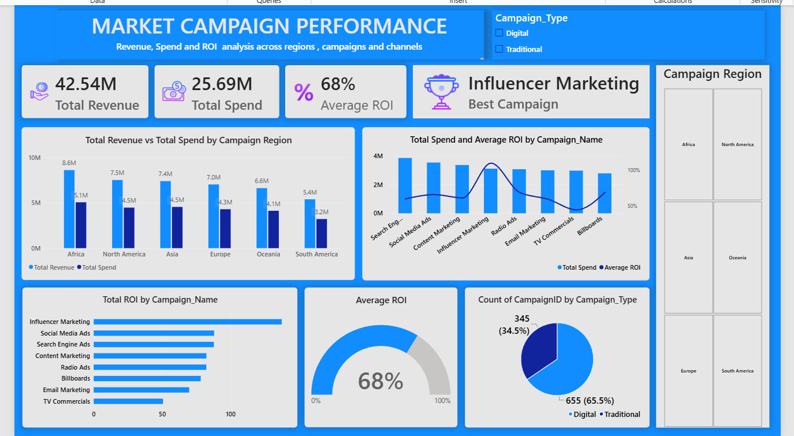

# Marketing Campaign Performance Analysis

**From marketing data to business insights | Power BI**

An interactive dashboard analysing campaign revenue, marketing spend, ROI, and regional performance to support better marketing decisions.

**Navigate:** [Dashboard Preview](#dashboard-preview) · [Key Findings](#key-findings) · [Business Recommendations](#business-recommendations) · [Tools Used](#tools-used)

---

## Dashboard Preview



*An overview of campaign performance across regions, channels, and campaign types.*

## Project Overview

Marketing teams need to understand whether their campaigns are delivering worthwhile returns. This project brings key performance indicators into one Power BI dashboard to compare campaigns, explore regional differences, and identify areas for further investigation.

**Business objective:** Understand which campaigns show stronger reported returns and where further analysis could improve marketing decisions.

## Key Findings

| Metric | Dashboard Result |
|:--|--:|
| Total Revenue | 42.54M |
| Total Spend | 25.69M |
| Average ROI | 68% |
| Highest displayed ROI | Influencer Marketing |
| Digital campaign share | 65.5% |

- **Campaigns:** Influencer Marketing has the highest bar in the displayed ROI comparison.
- **Regions:** Africa records the highest revenue among the displayed regions; South America records the lowest.
- **Campaign mix:** Digital campaigns account for 65.5% of campaign records. This does not necessarily mean they are more effective.

## Business Story

### 01 — Problem

How can a marketing team compare campaign performance and make informed budget decisions? Revenue alone does not show whether a campaign delivers strong returns, so spending and ROI must also be considered.

### 02 — Evidence

The dashboard compares revenue and spend by region, reported ROI by campaign, and campaign distribution by type. These metrics provide a starting point for understanding performance differences.

### 03 — Investigation

I compared campaign spending with reported ROI, explored regional revenue patterns, and reviewed the balance between Digital and Traditional campaigns. These views highlight patterns that may deserve closer attention.

### 04 — Business Recommendations

- Investigate the factors behind Influencer Marketing's reported ROI.
- Review lower-ranked campaigns to identify opportunities for improvement.
- Compare regional campaign mix, spending, and conversion outcomes.
- Evaluate Digital and Traditional campaigns using consistent performance metrics.
- Validate the ROI formula before making significant budget changes.

### 05 — Conclusion

The dashboard provides a consolidated view of marketing performance. Its key lesson is to consider revenue, spend, and returns together rather than judging campaigns by one metric alone. Further validation is needed before making major budget decisions.

## Dashboard Features

| Visual | Purpose |
|:--|:--|
| KPI cards | Summarise revenue, spend, average ROI, and the leading campaign |
| Regional comparison | Compare revenue and spend across regions |
| Campaign comparison | Explore campaign spending and reported ROI |
| ROI bar chart | Compare ROI across campaign names |
| ROI gauge | Display average ROI |
| Campaign type chart | Show campaign record distribution |
| Interactive filters | Explore campaign types and regions |

## Tools Used

**Power BI** · **Power Query** · **DAX** · **CSV** · **Business Analysis**

Used for data preparation, KPI reporting, campaign comparisons, visual analysis, and communicating business findings.

## Project Structure

```text
Marketing-Campaign-Analysis/
├── dashboard/
│   └── Marketing-Campaign-Analysis.pbix
├── data/
│   ├── marketing campaign details.csv
│   ├── marketing campaign performance.csv
│   └── region performance.csv
├── screenshots/
│   └── Marketing-Campaign-Performance-Dashboard.png
└── README.md
```

## How to Explore

1. Download or clone the repository.
2. Open the Power BI file in Power BI Desktop.
3. Update the CSV source paths if necessary.
4. Refresh the data if prompted.
5. Use the available filters to explore campaign performance.

## Notes & Limitations

- ROI should be interpreted according to the dataset definition and underlying DAX calculation.
- Revenue minus marketing spend is not net profit because other costs may apply.
- Campaign counts describe distribution, not effectiveness.
- Findings are descriptive and do not prove causation.

---

*Created to practise data analysis, dashboard development, and business storytelling with Power BI.*
